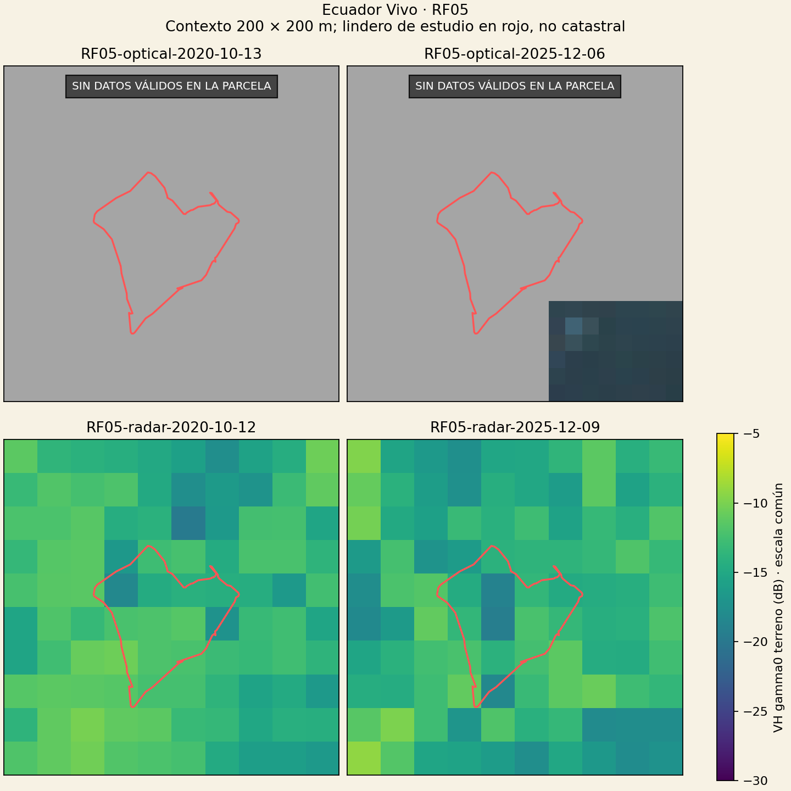
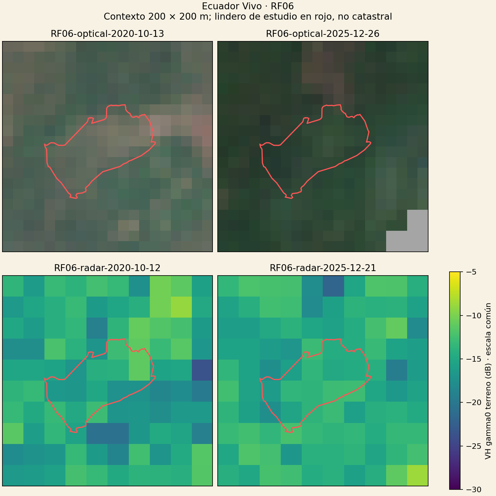

# Ecuador Vivo · parcelas reales RF05 y RF06

Comparación exploratoria 2020–2025, no certificación ni demostración de deforestación.

Referencia: ReforesTree, CC BY 4.0, https://zenodo.org/records/6813783. Polígonos originales válidos, no límites catastrales.
Óptico: reflectancia Sentinel-2 L2A a paso 10 m; QA SCL de 20 m con vecino más cercano. Radar: Sentinel-1A IW VV/VH, gamma0 terreno, paso 20 m, sin filtro speckle.
Tres candidatos ópticos por época, preseleccionados por nubosidad de escena; selección final por soporte válido dentro de la parcela. Radar de una misma órbita relativa por parcela, separación máxima 12 días.
Las estadísticas usan soporte válido común entre épocas; se muestran centros interiores y celdas totalmente contenidas por separado. No son observaciones independientes ni una precisión posicional.
Gris en el óptico = datos descartados por QA; no significa suelo desnudo ni pérdida de vegetación. Contexto exterior visible únicamente como referencia; no entra en las estadísticas.
Octubre–diciembre agrupa meses distintos: la estacionalidad, el manejo y la humedad siguen siendo factores de confusión. Dos fechas no demuestran una tendencia persistente.

## RF05

Radar: órbita relativa 40, DESCENDING; EPSG:32717.
Soporte común óptico: 0 centros / 0 celdas completas. Radar: 10 centros / 3 celdas completas.

| Época | Óptico | Radar | Separación |
|---|---|---|---:|
| 2020 | RF05-optical-2020-10-13 | RF05-radar-2020-10-12 | 1 días |
| 2025 | RF05-optical-2025-12-06 | RF05-radar-2025-12-09 | 3 días |

| Época | Sensor | Soporte | Valor | Unidad |
|---|---|---|---:|---|
| 2020 | optical | centres | Sin soporte | NDVI |
| 2025 | optical | centres | Sin soporte | NDVI |
| 2020 | optical | full_cells | Sin soporte | NDVI |
| 2025 | optical | full_cells | Sin soporte | NDVI |
| 2020 | radar | centres | -13.0719 | VH gamma0 terrain dB of mean linear |
| 2025 | radar | centres | -14.1849 | VH gamma0 terrain dB of mean linear |
| 2020 | radar | full_cells | -12.5499 | VH gamma0 terrain dB of mean linear |
| 2025 | radar | full_cells | -15.4842 | VH gamma0 terrain dB of mean linear |
## RF06

Radar: órbita relativa 40, DESCENDING; EPSG:32717.
Soporte común óptico: 48 centros / 30 celdas completas. Radar: 10 centros / 5 celdas completas.

| Época | Óptico | Radar | Separación |
|---|---|---|---:|
| 2020 | RF06-optical-2020-10-13 | RF06-radar-2020-10-12 | 1 días |
| 2025 | RF06-optical-2025-12-26 | RF06-radar-2025-12-21 | 5 días |

| Época | Sensor | Soporte | Valor | Unidad |
|---|---|---|---:|---|
| 2020 | optical | centres | 0.5235 | NDVI |
| 2025 | optical | centres | 0.7454 | NDVI |
| 2020 | optical | full_cells | 0.5043 | NDVI |
| 2025 | optical | full_cells | 0.7438 | NDVI |
| 2020 | radar | centres | -14.5777 | VH gamma0 terrain dB of mean linear |
| 2025 | radar | centres | -14.3837 | VH gamma0 terrain dB of mean linear |
| 2020 | radar | full_cells | -13.8830 | VH gamma0 terrain dB of mean linear |
| 2025 | radar | full_cells | -14.0212 | VH gamma0 terrain dB of mean linear |

NDVI no identifica tala. Cambios de radar pueden reflejar humedad, estructura, manejo o geometría. Pocas celdas completas, nubes y errores de registro limitan las inferencias.
No se conoce fecha de tala ni bosque previo; años de siembra del inventario no son fechas de deforestación. Revisión humana y referencia histórica independiente pendientes.
Métodos del proveedor: https://documentation.dataspace.copernicus.eu/APIs/SentinelHub/Data/S1GRD.html y https://documentation.dataspace.copernicus.eu/APIs/SentinelHub/Data/S2L2A.html
Autor: Henry P. Conteron Moreta · Ecuador Vivo / Andes Pulso.
